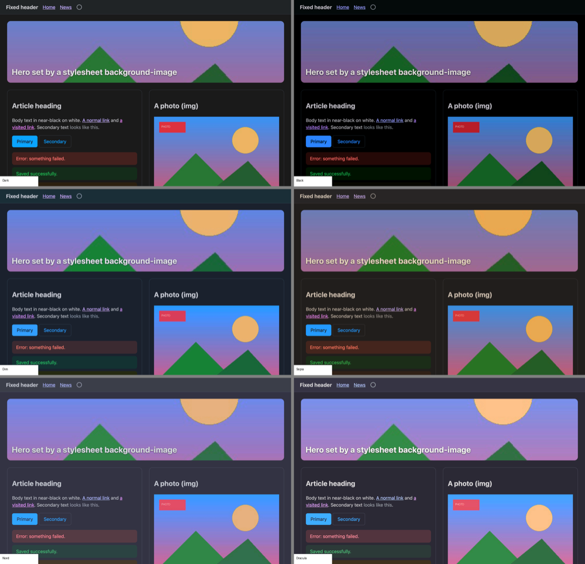
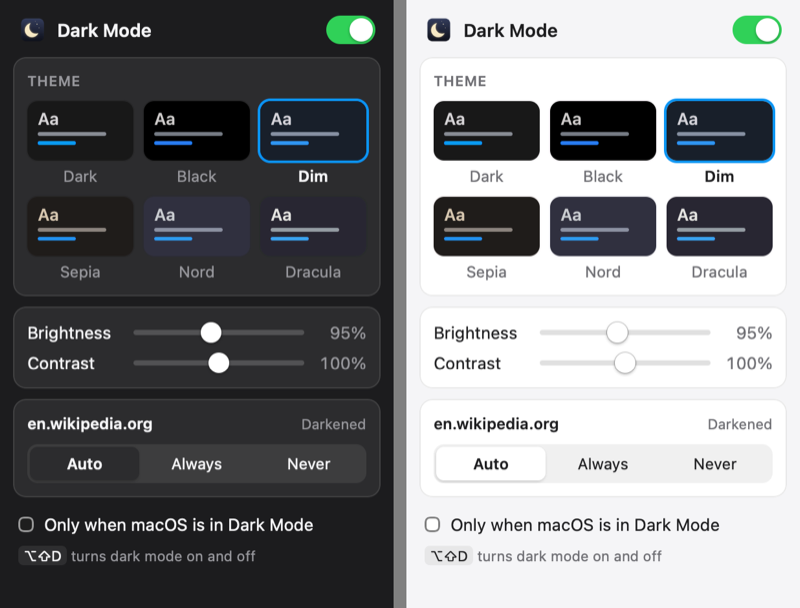
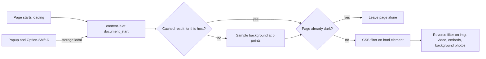

# Dark Mode for Safari

A Safari web extension for macOS that turns light websites dark, in six color themes, and leaves sites that are already dark alone.

**Plain-words write-up:** [Dark mode for any website in Safari](https://ryanwisth.github.io/safari-dark-mode.html)

## Why it exists

Many sites still have no dark theme. Instead of rewriting each page's CSS, this extension takes a smaller approach: one GPU-accelerated CSS filter on the page root, with themes whose filter values were fitted numerically so each one lands on a chosen background and text color. It was also an exercise in shipping a Safari extension end to end on a Mac without Xcode.



*All six themes (Dark, Black, Dim, Sepia, Nord, Dracula) rendered on the project's test page in WebKit by the `snap` harness. The photo and the stylesheet hero keep their real colors.*



## Features

- **Six themes:** Dark (neutral gray, default), Black (OLED), Dim (blue-gray), Sepia, Nord, Dracula.
- **Photos keep their colors.** Images, video and video/map embeds are flipped back after the page filter, including photos set as CSS background images.
- **Already-dark sites are left alone,** based on sampling the page's real background color.
- **Popup:** master switch, theme swatches (each drawn through that theme's real filter), Brightness and Contrast sliders (50-150 %, double-click resets), per-site Auto / Always / Never, and "Only when macOS is in Dark Mode".
- **Keyboard shortcut:** Option-Shift-D toggles dark mode.
- **Toolbar icon** shows state: filled crescent when on, outlined when off.
- **Minimal permissions:** `storage` only. No network access.

## How it works



Key design decisions and the reasoning behind them:

- **One filter, not a stylesheet rewriter.** A single CSS `filter` on `<html>` darkens every site with no per-site rules and no flash of rewritten CSS. The cost: images baked into a page's own background artwork can stay light. Per-site Never covers those cases. A full dynamic-CSS engine would be a much bigger build.
- **CSS shorthand filters only, no SVG `url()` filters.** Safari renders SVG filters in software; the shorthand filters run on the GPU.
- **Filter on the root element.** Per the CSS spec, a filter on the root does not create a containing block for `position: fixed`, so fixed headers keep working. Checked by scrolling in WebKit.
- **Themes are fitted, not hand-tuned.** `tools/fit_themes.py` runs Nelder-Mead optimization (12 restarts) over the Filter Effects Level 1 color matrices, scoring error in the OKLab color space, so each theme lands on its target background and text color. Final fit error (background / text, ΔE in OKLab): Dark 0.4/0.1, Black 0.0/0.8, Dim 0.6/0.5, Sepia 0.9/0.1, Nord 0.2/0.7, Dracula 0.2/0.2. The script writes `extension/themes.js`; that file is generated and should not be hand-edited.
- **Tint before invert.** A sepia tint applied after the invert multiplies a near-black background and barely shows; applied before, it lands on the background rather than the text.
- **Per-theme reverse filter** `saturate(r) invert(1) hue-rotate(180deg)`. The invert and hue-rotate round trip clips saturated colors (yellow came back beige). Pre-desaturating by a fitted `r` keeps photos close to true; a photo-fidelity term in the fit balances this against the theme's tint.
- **SVG images are not flipped back.** They are mostly logos in dark ink; flipping them made dark wordmarks disappear.
- **Already-dark detection.** Five `elementFromPoint` samples, walking up to the effective background (then body, then the canvas color from `color-scheme`); dark if luminance is below 0.18. The result is cached per host and light/dark appearance, so a revisit applies the right state at `document_start`.
- **Top frame only.** The root filter already covers iframes visually; filtering inside them too would invert twice.
- **No Xcode.** The app and its app extension are compiled with `swiftc`, assembled into bundles by hand and signed ad hoc by `tools/build.sh`. The app is plain AppKit, because SwiftUI macros need Xcode's macro plugins.

## Quick start

**Requirements:** macOS 13 or later on Apple silicon (the build targets `arm64-apple-macos13.0`), Safari, and the Xcode Command Line Tools (`swiftc`, `xcrun`, `codesign`). Python 3 with Pillow is needed for the first build, which draws the icons; NumPy is needed only to refit the themes.

```bash
pip install -r requirements.txt     # Pillow + NumPy, for the tools only

tools/build.sh                      # build -> build/Dark Mode for Safari.app (signed ad hoc)
tools/build.sh --install            # build, install to /Applications, register with Safari, open the app
```

`--install` replaces `/Applications/Dark Mode for Safari.app` only if the bundle there has this project's bundle ID, and it removes the `build/` copy afterwards so Safari never sees two registered copies. If you fork this, change the bundle IDs in `app/App-Info.plist`, `app/Ext-Info.plist`, `app/App.swift` and `tools/build.sh`.

**Turning it on in Safari.** Because the app is signed ad hoc rather than with an Apple developer team, Safari loads it only while unsigned extensions are allowed:

1. Safari > Settings > Advanced > "Show features for web developers".
2. Settings > Developer > "Allow unsigned extensions".
3. Settings > Extensions > enable "Dark Mode" and allow it on every website.
4. Use the moon button in the toolbar, or Option-Shift-D.

Safari clears "Allow unsigned extensions" every time it quits, so steps 2 and 3 repeat after each restart. Signing with an Apple ID team in Xcode would remove that step.

**Developer tools:**

```bash
python3 tools/fit_themes.py         # refit all themes (~100 s); rewrites extension/themes.js
python3 tools/make_icons.py         # redraw extension icons and build/AppIcon.icns
mkdir -p build && swiftc -O tools/snap.swift -o build/snap
build/snap tools/testpage.html out.png --settings '{"theme":"nord"}'   # WebKit render with the extension injected
```

`snap` options: `<url|file> <out.png> [--settings JSON] [--dark] [--width N] [--height N] [--wait S] [--eval JS] [--scroll PX] [--no-inject] [--popup]`. It loads the extension into the system WebKit (the engine Safari uses) with a stand-in `browser` API, so its renders are a close proxy for Safari but not Safari's extension runtime.

## Project structure

```
extension/            The web extension (Manifest V3)
  manifest.json
  content.js          Runs at document_start: detection, filter injection, background-photo scan
  shared.js           Settings load/save/normalize; builds the filter string
  themes.js           Generated by tools/fit_themes.py; do not edit by hand
  background.js       Keyboard command and toolbar icon state
  popup/              Popup UI (light and dark appearance)
  icons/              Generated by tools/make_icons.py
app/                  Container app and app extension (Swift, AppKit), plists, sandbox entitlements
tools/
  build.sh            Build, sign ad hoc, optionally install and register
  fit_themes.py       Fits each theme's filter chain
  make_icons.py       Draws all icons with Pillow
  snap.swift          WKWebView screenshot harness with a fake extension API
  test*.html          Detection and rendering test pages (test-photo.jpg is a generated test image)
docs/                 README images
```

## Status

**Built and installed on the author's Mac; not yet confirmed in real Safari.**

- Version 1.0.0 builds, signs ad hoc and registers with Safari's extension system (`pluginkit` lists it).
- Every render check so far ran in WebKit through the `snap` harness with a stand-in extension API: theme rendering, fixed headers while scrolling, photo flip-back, already-dark detection (native dark pages, `color-scheme` meta, follow-system, per-site Always/Never), the popup in light and dark, and a few live sites.
- The popup's status line and the Option-Shift-D command have only been exercised against the stand-in API.

Known limits:

- Ad-hoc signing means the "Allow unsigned extensions" step after every Safari restart.
- The exact Safari menu path for that setting on the newest macOS is unverified; it has been under Settings > Developer since Safari 17.
- Product photos that include their own white background (for example large hero images) stay light. Use per-site Never.
- On one large wiki site at 1280 px wide, small gray boxes appear over some sidebar icons. Root cause unknown; a minimal repro (`tools/test-mask*.html`) renders correctly.
- A single light frame may show on a site's first visit, because settings load asynchronously. Not observed in the harness; unverified in Safari.

## How this was built

Ryan Wisth built this by directing an AI coding agent (Claude Code): he set the goal, the feature list and the acceptance checks, and reviewed the results. The agent wrote the code, the theme-fitting script and the WebKit test harness, and ran the render checks described above.

## License

MIT; see [LICENSE](LICENSE). Safari and macOS are trademarks of Apple Inc. This project is not affiliated with or endorsed by Apple. Nord and Dracula are the names of independent open-source color schemes; the themes here only approximate their background and text colors.
